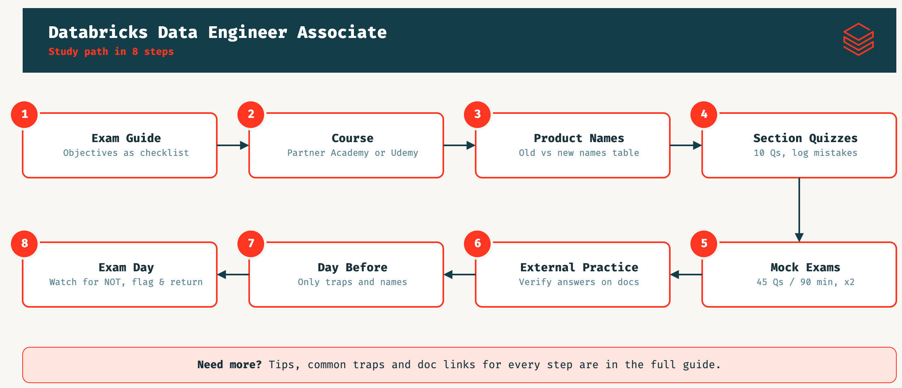

# Come superare l'esame Databricks Certified Data Engineer Associate

Guida passo passo, scritta dopo aver superato l'esame (ottobre 2026).

---

## 1. L'esame in breve

| Voce         | Dato                                                                                              |
|--------------|---------------------------------------------------------------------------------------------------|
| Domande      | 45 a risposta multipla valutate (più eventuali domande non valutate, con tempo extra già incluso) |
| Durata       | 90 minuti, circa 2 minuti a domanda                                                               |
| Costo        | 200 USD più tasse                                                                                 |
| Modalità     | online (proctored) o presso test center, nessun materiale ammesso                                 |
| Prerequisiti | nessuno; consigliati un corso e circa 6 mesi di esperienza pratica                                |
| Validità     | 2 anni; si rinnova rifacendo l'esame in vigore                                                    |

Pagina ufficiale della certificazione (iscrizione e guida d'esame
aggiornata): https://www.databricks.com/learn/certification/data-engineer-associate

### Le 7 sezioni e il loro peso (versione d'esame in vigore a ottobre 2026)

| # | Sezione                                       | Peso | Domande circa |
|---|-----------------------------------------------|------|---------------|
| 1 | Databricks Intelligence Platform              | 6%   | 3             |
| 2 | Data Ingestion and Loading                    | 21%  | 9             |
| 3 | Data Transformation and Modeling              | 22%  | 10            |
| 4 | Working with Lakeflow Jobs                    | 16%  | 7             |
| 5 | Implementing CI/CD                            | 10%  | 4-5           |
| 6 | Troubleshooting, Monitoring, and Optimization | 10%  | 4-5           |
| 7 | Governance and Security                       | 15%  | 7             |

Il numero di domande è una stima calcolata dai pesi, non un dato ufficiale. Le sezioni 2, 3 e 4 valgono quasi il 60%: è
lì che si passa l'esame.

---

## 2. Gli step, in ordine

                                                                                                                                                                                                                                                                                                                                                                                                                                                                           
                                                                                                                                                                                                                                                                                                                                                                    
  
 

### Step 1. Scarica la guida d'esame ufficiale e trasformala in una checklist

La guida (PDF) elenca gli obiettivi parola per parola. Copiali in un file, uno per riga, e usali come checklist per
tutto lo studio. Due regole:

- **Studia solo quello che c'è nella guida.** Se un argomento non compare tra gli obiettivi, non vale il tempo.
- **Controlla la data di versione.** La guida viene aggiornata periodicamente: corsi e practice exam vecchi possono
  coprire obiettivi tolti o mancare quelli nuovi.

Le domande d'esempio della guida possono venire da versioni precedenti dell'esame: usale per capire il formato, non la
terminologia.

### Step 2. Segui un corso

Va fatto per primo, prima di quiz e simulazioni: serve per avere una copertura completa e ordinata di tutti gli
obiettivi. Anche chi usa Databricks da tempo ci trova le parti che nel lavoro quotidiano non si toccano (ABAC, bundle,
Lakeflow Connect, If/else e For each nei job).

**Consigliato**

- **Data Engineer Learning Plan su Databricks Partner
  Academy**: https://partner-academy.databricks.com/learn/learning-plans/10/data-engineer-learning-plan
  È il percorso ufficiale e il più allineato alla guida. Attenzione: è accessibile solo se la tua azienda è partner
  Databricks e hai un account sulla Partner Academy.

**Alternative**

- **Corso Udemy per l'Associate**: https://www.udemy.com/course/databricks-certified-data-engineer-associate/
  La scelta se non hai accesso alla Partner Academy. Prima di comprarlo controlla che sia aggiornato alla versione
  d'esame in vigore.
- **Corsi self-paced di Databricks Academy** elencati nella guida d'esame: Data Ingestion with Lakeflow Connect; Deploy
  Workloads with Lakeflow Jobs; DevOps Essentials for Data Engineering; Data Interoperability with Unity Catalog; Build
  Data Pipelines with Lakeflow Spark Declarative Pipelines; Get Started with Data Governance on Databricks. C'è anche il
  corso con istruttore "Data Engineering with Databricks". Catalogo: https://www.databricks.com/learn/training

### Step 3. Verifica se i nomi dei prodotti sono stati aggiornati

Databricks rinomina spesso i prodotti e l'esame usa i nomi della guida, che a volte sono già diversi da quelli della
documentazione. Prima di studiare, preparati una tabella di corrispondenza. Le principali:

| Nome nella guida (vale all'esame)    | Nomi vecchi                         | Nome nella doc a ottobre 2026  |
|--------------------------------------|-------------------------------------|--------------------------------|
| Lakeflow Jobs                        | Databricks Jobs, Workflows          | Lakeflow Jobs                  |
| Lakeflow Spark Declarative Pipelines | Delta Live Tables (DLT)             | Lakeflow pipelines             |
| Declarative Automation Bundles       | Databricks Asset Bundles (DABs)     | Declarative Automation Bundles |
| Databricks Git Folders               | Databricks Repos                    | Git folders                    |
| Data Intelligence Platform           | Lakehouse Platform                  | Data + AI Platform             |
| Access mode Standard / Dedicated     | Shared / Single user                | Standard / Dedicated           |
| Dashboard (task dei job)             | Lakeview, Databricks SQL dashboards | AI/BI dashboards               |

### Step 4. Quiz per sezione, con ripasso degli errori

Dopo il corso, passa ai quiz in stile esame: 10 domande, una o due sezioni alla volta. Puoi far generare i quiz a
qualsiasi tool di IA, così come spiega
la [guida](https://www.databricks.com/sites/default/files/2026-06/ai-prep-guide-any-databricks-certification.pdf) stessa
di databricks. Questi sono i prompt chiave che ho dato all'assistente IA:

- Spiegazione **solo per le risposte sbagliate**, con il link alla pagina della doc che la giustifica.
- Tieni un registro degli errori (argomento e regola corretta). Gli errori si ripetono: lo stesso concetto sbagliato due
  o tre volte è una trappola da mettere in lista.
- Ogni 3-4 quiz, fanne uno "misto" che ripropone gli argomenti sbagliati in precedenza (ripasso distanziato).
- Copri tutti gli obiettivi, anche quelli di nicchia (parametri di tuning Spark, JDBC/REST, partner connectors,
  conversione managed/external).

> [!TIP]
> Per quanto riguarda la configurazione della tua AI, non ho usato tutti gli step descritti dalla guida.
> Quelli realmente utili dal mio punto di vista sono: *Step 1*, *Step 3*, *Step 4* (Orient e Practice), *Step 5*.

### Step 5. Simulazioni complete a tempo

Quando i quiz sono stabilmente sopra l'85%, fai una simulazione vera: 45 domande in 90 minuti, distribuite per peso di
sezione, senza guardare nulla. Puoi spezzarla in 3 blocchi da 15 domande e 30 minuti. Fanne almeno due, con domande
diverse.
Obiettivo: arrivare con margine. La soglia di superamento non è pubblicata nella guida, quindi punta ad almeno l'80%
nelle simulazioni.

### Step 6. Practice exam esterni

I practice exam di [Udemy](https://www.udemy.com/) (o altri siti
come [SkillCertPro](https://skillcertpro.com/my-account/)) sono utili per abituarsi a domande scritte da altri, con
stile
e trabocchetti diversi dai tuoi
quiz. Due avvertenze:

- Alcune risposte possono essere sbagliate o superate: **verifica sempre sulla doc ufficiale** prima di "imparare" una
  risposta che ti sembra strana.
- Controlla che siano aggiornati alla versione d'esame in vigore.

### Step 7. Il giorno prima: solo trappole

Niente argomenti nuovi. Rileggi il registro degli errori riordinato per frequenza (vedi sezione 4) e la tabella dei
nomi.

### Step 8. Il giorno dell'esame

- Per l'esame online: controlla prima webcam, connessione e scrivania sgombra.
- Leggi tutta la domanda: molte chiedono quale opzione **NON** è corretta.
- Davanti a un numero (per esempio 7, 14, 30, 60 giorni) chiediti di quale comando si parla prima di rispondere.
- Se un'opzione usa un nome vecchio (DLT, Repos, DABs) e un'altra il nome della guida, di solito quella giusta usa il
  nome della guida.
- Segna le domande dubbie e torna dopo: 2 minuti a domanda bastano, ma non fermarti troppo su una sola.

---

## 3. Piano di studio

### Piano da 2 settimane (usi già Databricks da almeno 6 mesi-1 anno)

| Giorni | Cosa                                                                                                           |
|--------|----------------------------------------------------------------------------------------------------------------|
| 1-4    | Corso (anche a velocità aumentata, saltando le parti che conosci), checklist degli obiettivi, tabella dei nomi |
| 5-9    | 2-3 quiz al giorno da 10 domande per sezione, registro errori; un quiz misto ogni 3-4                          |
| 10     | Simulazione 1 (45 domande, 90 minuti) e ripasso degli errori                                                   |
| 11-12  | Practice exam esterni, verifica sulla doc delle risposte dubbie; quiz mirati sui punti deboli                  |
| 13     | Simulazione 2                                                                                                  |
| 14     | Solo trappole e nomi, poi riposo                                                                               |

### Piano da 4-6 settimane (esperienza limitata)

| Settimane | Cosa                                                                                                                                                                                                  |
|-----------|-------------------------------------------------------------------------------------------------------------------------------------------------------------------------------------------------------|
| 1-2       | Corso completo, con esercizi pratici in un workspace (anche di prova): Auto Loader, COPY INTO, una pipeline dichiarativa, un job con più task, un bundle deployato con la CLI, GRANT su Unity Catalog |
| 3-4       | Quiz per sezione, partendo dalle sezioni 2, 3 e 4 (le più pesanti); registro errori                                                                                                                   |
| 5         | Prima simulazione, practice exam esterni, ripasso degli errori                                                                                                                                        |
| 6         | Seconda simulazione, trappole, esame                                                                                                                                                                  |

---

## 4. Le trappole più frequenti (per lo meno che sbagliavo io)

Ordinate da quelle sbagliate più spesso durante la preparazione. Ogni regola ha la pagina della doc che la conferma.

### Permessi: GRANT, REVOKE e DENY

- `GRANT ... TO gruppo`, `REVOKE ... FROM gruppo`. Aggancio: dai *a* qualcuno, togli *da* qualcuno.
- `DENY` non è supportato da Unity Catalog, solo dal legacy hive_metastore. La guida lo cita (obiettivo 7.2), ma se
  un'opzione usa DENY su Unity Catalog, scartala.
- Doc: https://docs.databricks.com/aws/en/sql/language-manual/security-revoke
  e https://docs.databricks.com/aws/en/sql/language-manual/security-deny

### Le durate

| Giorni | Cosa                                                                                                  |
|--------|-------------------------------------------------------------------------------------------------------|
| 7      | UNDROP (default), file eliminabili da VACUUM (`deletedFileRetentionDuration`), time travel affidabile |
| 14     | UNSET MANAGED (rollback di SET MANAGED)                                                               |
| 30     | log Delta (`logRetentionDuration`), staging di Lakeflow Connect                                       |
| 60     | cronologia delle esecuzioni dei job (oltre: system table)                                             |

Aggancio: UNDROP e VACUUM sono le operazioni "pericolose", quindi hanno la finestra più corta; UNSET MANAGED è il
doppio. Da Databricks Runtime 18.0 il time travel oltre i 7 giorni viene bloccato.
Doc: https://docs.databricks.com/aws/en/tables/history, https://docs.databricks.com/aws/en/sql/language-manual/sql-ref-syntax-ddl-undrop-table, https://docs.databricks.com/aws/en/tables/convert-to-managed

### Auto Loader: evoluzione dello schema

- **Senza schema:** default `addNewColumns`. Lo stream fallisce con `UnknownFieldException` e al riavvio riparte con la
  colonna nuova.
- **Con schema fornito:** default `none`. La colonna nuova viene ignorata; per non perderla serve `rescuedDataColumn`.
- JSON, CSV e XML vengono inferiti come stringhe, a meno di `cloudFiles.inferColumnTypes`.
- `includeExistingFiles` vale solo al primo avvio; file events con `useManagedFileEvents=true` da solo, senza
  `useNotifications`.
- Doc: https://docs.databricks.com/aws/en/ingestion/cloud-object-storage/auto-loader/schema
  e https://docs.databricks.com/aws/en/ingestion/cloud-object-storage/auto-loader/options

### Lakeflow Jobs: If/else e For each

- `==` e `!=` confrontano **stringhe** (`"10" == "10.0"` è false); `>`, `>=`, `<`, `<=` confrontano **numeri**.
- Il ramo falso si sceglie con Depends on `check (false)`; il default è `(true)`. Una condizione falsa non è un
  fallimento.
- For each: Concurrency di default 1; il valore corrente si legge con `{{input}}` o `{{input.chiave}}`.
- Doc: https://docs.databricks.com/aws/en/jobs/tasks/if-else e https://docs.databricks.com/aws/en/jobs/tasks/for-each

### Streaming table o materialized view

- Una streaming table elabora ogni riga una volta: se cambia la tabella di dimensione del join, non ricalcola. Per
  quello serve una materialized view.
- Per rielaborare le righe già caricate: `REFRESH STREAMING TABLE ... FULL`. AUTO CDC scrive sempre in una streaming
  table.
- Doc: https://docs.databricks.com/aws/en/ldp/concepts/materialized-views
  e https://docs.databricks.com/aws/en/ldp/dbsql/streaming

### COPY INTO

- `FORMAT_OPTIONS` riguarda i file (`header`, `modifiedAfter`, `pathGlobFilter`...); `COPY_OPTIONS` riguarda il comando
  (solo `force` e `mergeSchema`).
- Doc: https://docs.databricks.com/aws/en/sql/language-manual/delta-copy-into

### Compute e SQL warehouse

- Livelli: Classic = Photon; Pro = + Predictive IO; Serverless = + Intelligent Workload Management.
- Pro gira nel tuo account cloud (networking personalizzato, dati on-prem); Serverless parte in pochi secondi.
- Il serverless non supporta RDD, R e Scala nei notebook: per R e RDD serve compute classico con access mode Dedicated.
- Doc: https://docs.databricks.com/aws/en/compute/sql-warehouse/warehouse-types
  e https://docs.databricks.com/aws/en/compute/serverless/limitations

### JSON e VARIANT

- `from_json` vuole sempre uno schema (modalità di default PERMISSIVE); `parse_json` non lo vuole e restituisce VARIANT.
- Doc: https://docs.databricks.com/aws/en/sql/language-manual/functions/from_json
  e https://docs.databricks.com/aws/en/semi-structured/variant

### Varie

- Nelle Lakeflow Spark Declarative Pipelines un'expectation senza `ON VIOLATION` registra solo un warning, i record
  vengono scritti (https://docs.databricks.com/aws/en/ldp/expectations).
- Gli alert SQL non supportano parametri.
- Le variabili dei bundle si risolvono al deploy; per valori diversi a ogni esecuzione si usano i job parameters
  (https://docs.databricks.com/aws/en/dev-tools/bundles/variables).
- Le pull request si aprono nel provider Git, non dai Git folders, anche se la guida dice il contrario
  (https://docs.databricks.com/aws/en/repos/git-operations-with-repos).
- Il file arrival trigger vuole un volume o una external location di Unity Catalog
  (https://docs.databricks.com/aws/en/jobs/file-arrival-triggers).
- AQE gestisce da solo lo skew nei sort merge join; il broadcast serve per una tabella piccola, non per lo skew
  (https://docs.databricks.com/aws/en/optimizations/aqe).
- Per creare una tabella external servono `CREATE EXTERNAL TABLE` sulla external location e `CREATE TABLE` sullo schema
  (https://docs.databricks.com/aws/en/tables/external).

---

## 5. Regole sulle fonti

- **Solo fonti ufficiali** per decidere qual è la risposta giusta: docs.databricks.com e Databricks Academy. Blog, forum
  e video vanno bene per capire, non per verificare.
- **Ogni regola che impari deve avere un link alla doc.** Se non trovi la pagina che la conferma, segnala il dubbio
  invece di memorizzarla.
- **Nomi della guida all'esame**, nomi della doc per cercare.
- La doc non riporta tutto: per esempio i valori di default di `spark.sql.autoBroadcastJoinThreshold`,
  `spark.default.parallelism` e della memoria di executor e driver (obiettivo 3.5) non sono indicati. Non perdere tempo
  a memorizzare numeri che non trovi nella doc.
- I practice exam esterni sono allenamento, non verità: in caso di conflitto vince la doc.
